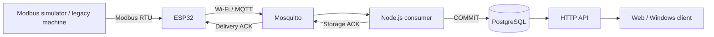
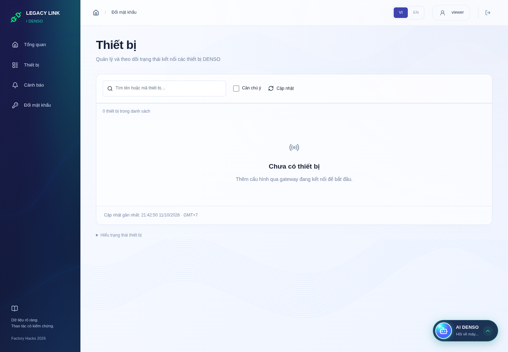
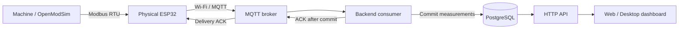

# Legacy Link


## Start here — DENSO D1 submission

Legacy Link targets monitoring on legacy Modbus equipment without an industrial
PC. A physical ESP32 collects register values; reusable profiles and a test-read
before apply help check the configuration before it becomes active.

- [Live demo](https://vineyard-fifteen-elusive.ngrok-free.dev/) — requires a
  team-provided Viewer account and the team server to be online. Share judge
  credentials privately through the submission form.
- [Windows/macOS client](https://github.com/thinhnguyen672007-alt/Legacy-link/releases/latest)
  — connects to the team server; it is not a standalone offline backend.
- [Measured evidence and limits](docs/submission-evidence.md).
- [Cost scope and comparison method](docs/cost-analysis.md).

**Video:** the final 2–3 minute narrated recording has not been published yet.
Add its verified URL here and to the submission form before submission.

**Bench scope:** Modbus register values are simulated; the ESP32 and the
MQTT/backend/database path are physical/running components. No real CNC/PLC or
industrial RS-485 acceptance is claimed.




*Frame from the supplied Web recording. Values originate from the Modbus bench
simulator; this screenshot does not establish a physical CNC measurement or the
current live state.*

| Recorded result | Scope |
| --- | --- |
| Profile A/B without reflashing | Physical ESP32 bench; machine register maps |
| Lost ACK: four replays, one database row | Bounded firmware acceptance test |
| Consumer/database/broker outage recovery | Short outages; pending RAM samples drained |

Pending samples are held in RAM: 32 telemetry samples and 8 alarms. Power loss
clears them, and a full queue drops new samples. See the evidence report before
interpreting recovery as a lossless-storage guarantee.

## Team

| Member | Main role |
| --- | --- |
| Nguyễn Vũ Đức Thịnh | Backend, telemetry persistence and API |
| Trần Hoàng Anh | ESP32 firmware, Modbus acquisition and profiles |
| Phạm Tuấn Huy | MQTT, PostgreSQL and Docker infrastructure |

```text
Modbus RTU machine / OpenModSim
    -> ESP32 -> Wi-Fi / MQTT -> Node.js backend -> PostgreSQL -> HTTP API
                                                                    -> React frontend
```
Connect legacy equipment to a live dashboard using an ESP32.
Built for **DENSO Factory Hacks · D1**: configurable Modbus maps and alarms,
without an industrial PC or reflashing for each machine profile.

## Demo for judges

**[Open live demo](https://vineyard-fifteen-elusive.ngrok-free.dev/)** · **[Download desktop app](https://github.com/thinhnguyen672007-alt/Legacy-link/releases/latest)**

Sign in with a team-provided account. Judge access should use a read-only account;
credentials are shared separately from this public repository. The live demo runs
on a team laptop and is available while that laptop and its network are online.

**Demo video (2–3 minutes):** pending publication. The submission package should
include the video link as an offline-review alternative to the live demo.

In the bench demo, OpenModSim simulates machine registers. A physical ESP32 reads
them and sends measurements to the backend; no real CNC is connected. Open a device
to inspect temperature, current, RPM, measurement freshness and history. Alarm
history shows previous threshold tests; normal operation need not raise an alarm.



*Dashboard preview from a UI validation session with an empty device catalog;
this image illustrates the interface, not live measurement evidence.*

## Architecture



## What it does

- Collects named measurements, applies scaling and detects configurable alarms.
- Retries queued measurements until the backend confirms database storage; duplicate messages do not create duplicate records.
- Supports test-read → apply commissioning, employee accounts (admin/read/write), history and AI-assisted investigation.
- Provides a React dashboard and Windows/macOS desktop client. From desktop 0.1.5, the client uses the configured team server automatically.

## Get started

**Use the app:** download an available installer from [GitHub Releases](https://github.com/thinhnguyen672007-alt/Legacy-link/releases/latest), then sign in with an account provided by your administrator. See [desktop installation](desktop/README.md).

**Host the stack:** install Docker Engine and Compose v2, then run:

```bash
cd infrastructure
docker run --rm --user "$(id -u):$(id -g)" -v "$PWD:/work:z" -w /work node:22-alpine node scripts/prepare-env.mjs
# Set DEMO_LAN_IP in .env, then repeat the preparation command above.
docker compose up -d --build --wait
```

Open `http://<server-LAN-IP>:8080`. For a new database, use the admin credentials
generated in the ignored `infrastructure/.env`. Existing accounts retain their
passwords. For upgrades, backups and remote access, follow the
[infrastructure guide](infrastructure/README.md).

**Connect an ESP32:** follow the [firmware guide](firmware/legacy-link-core/README.md).
It requires 2.4 GHz Wi-Fi and local broker credentials. Real equipment needs the
appropriate RS-485 interface; the OpenModSim bench uses verified 3.3 V UART wiring.

## Project guide

| Component | Documentation |
| --- | --- |
| `telemetry` | ESP32 -> backend: named numeric `metrics` object |
| `status` | ESP32 -> backend: boolean `status`, retained, with offline Last Will |
| `alarm` | ESP32 -> backend: `code`, `severity`, `value` |
| `config` | Controller -> ESP32: update the currently assigned device |

Telemetry, status and alarm payloads contain `schemaVersion: 1`, a matching
`deviceId`, and an integer epoch-millisecond `timestamp`. Firmware synchronizes
time before publishing measurements.

For initial setup or a device identity change, publish JSON at QoS 1 to
`legacy-link/gateways/{gatewayId}/config`; Serial prints the hardware gateway ID.
Check `legacy-link/gateways/{gatewayId}/config/ack` for application and persistence
results. Retained configuration is redelivered on reconnect and can overwrite
later Serial changes.

Configuration uses `registerMap[].key`, `address`, `functionCode`, `dataType` and
`scale`. Addresses are raw zero-based values: holding register 40050 becomes 49.
Firmware applies scale once. Maps support 1–16 entries, payloads up to 4095 bytes;
invalid updates preserve the active configuration. Start with the
[example profiles](firmware/legacy-link-core/examples/) and consult
[backend alignment](firmware/legacy-link-core/docs/backend-alignment.md) or
[firmware operation](firmware/legacy-link-core/docs/firmware-operation.md) for details.

## Quick machine commissioning API

The backend and firmware support adding a machine through a test-read before apply:
`GET /gateways`, `POST /gateways/{id}/probe`, `POST /gateways/{id}/apply`, and
`GET /operations/{requestId}`. Probe results expose raw and converted values;
apply requires a recent successful probe of the exact configuration and tracks
received, applied, flash-saved and restored-after-restart evidence separately.

`/machines` also exposes per-register diagnostics and `lastMeasurementAt` so the
team frontend can distinguish gateway contact from fresh machine measurements.
Run the updated schema, firmware, consumer and `npm run start:http`; see the
[API contract and curl demo](docs/commissioning-demo.md). The probe/apply flow has been exercised on a real ESP32
with a Modbus simulator (see the October 10 reports); commissioning on real
CNC/RS-485 hardware remains pending.

## Firmware delivery recovery

Telemetry (32 samples) and alarms (8 events) have independent RAM outboxes. Firmware
retries unchanged IDs until the C7–C10 backend confirms database COMMIT. The USB
`:health` command reports pending/committed counts, overflow attempts and rejected
head samples. ESP32 reset clears RAM queues; capacity bounds recovery time.
See the [delivery contract and acceptance runbook](docs/telemetry-delivery.md).

## Validation

After building firmware to install its dependencies, run from the repository root:
| ESP32 firmware, profiles and diagnostics | [Firmware](firmware/legacy-link-core/README.md) |
| HTTP/MQTT contracts | [OpenAPI](backend/openapi.json) · [Delivery contract](docs/telemetry-delivery.md) |
| Accounts and backend deployment | [Accounts](backend/deploy/ACCOUNTS.md) · [Deployment](backend/deploy/README.md) |
| Dashboard and frontend development | [Frontend](frontend/README.md) |
| Windows/macOS app | [Desktop](desktop/README.md) |
| Docker, broker, database and operations | [Infrastructure](infrastructure/README.md) |
| Machine setup through probe/apply | [Commissioning](docs/commissioning-demo.md) |

## Validation and limits

The ESP32 → Modbus simulator → MQTT → PostgreSQL path has physical test evidence
for telemetry, alarms, retries, duplicate handling and recovery. See the
[stack acceptance](docs/physical-acceptance-2026-10-10.md) and
[firmware acceptance](firmware/legacy-link-core/docs/physical-acceptance-2026-10-10.md).

| Demonstrated result | Recorded evidence |
| --- | --- |
| Recovery after consumer, database and broker outages | RAM outbox drained after service restoration in the stack acceptance run |
| Duplicate-safe delivery | 68 captured telemetry IDs with committed ACKs each matched exactly one database row |
| Lost ACK after database commit | Firmware replayed the sample; storage remained one row in the firmware acceptance run |
| Configurable acquisition and alarms | Profile A/B, signed values, scaling, high/critical escalation and rearming exercised on the bench |

These are bounded acceptance results, not a production reliability guarantee.

Real CNC/RS-485 acceptance remains separate from simulator testing. Firmware queues
are RAM-only (32 telemetry samples and 8 alarms); power loss clears pending data.
The demo deployment uses plaintext MQTT on a trusted LAN.

Run checks after installing each component's dependencies:

```bash
npm test --prefix backend
npm test --prefix frontend
npm run build --prefix frontend
npm test --prefix desktop
pio run -d firmware/legacy-link-core
bash firmware/legacy-link-core/test/host/run.sh
```

## License

No repository-wide license file has been selected. Package metadata lists ISC;
confirm licensing before external reuse. The logo's attribution is in
[LOGO-LICENSE.txt](desktop/assets/LOGO-LICENSE.txt).
