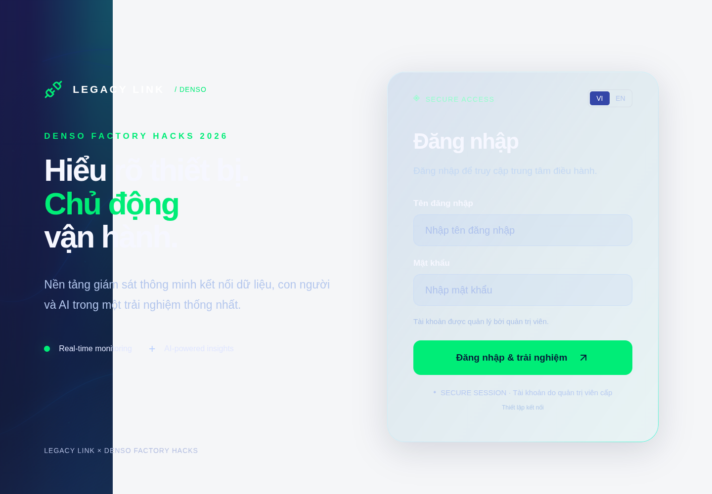
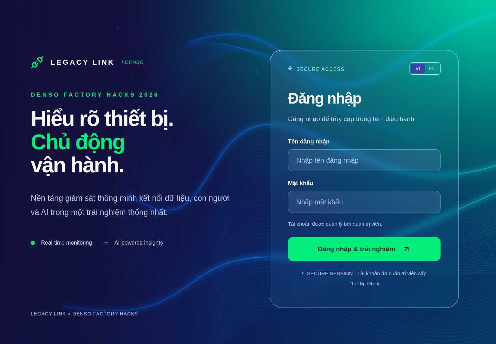

# Reload và chuyển về màn hình đăng nhập — 2026-10-11

## Nguyên nhân đã tái hiện

Chromium thật, backend `accounts-integration.mjs --serve` và PostgreSQL riêng, Vite 127.0.0.1:5174. Tạo employee qua UI admin, logout, đăng nhập employee, đổi mật khẩu bắt buộc. Không dùng mock auth, không sửa tài khoản/live DB.

Sau đổi mật khẩu, `.ll-morph-surface` còn class `collapsed`, computed width 228px trên viewport 1440px. Hero/card opacity vẫn 1, filter none; nền root `styles.css` #f5f6f8 lộ ra ngoài nền đã thu nhỏ, tạo khối trắng và cảm giác form mờ. `App` giữ `collapsing=true` từ animation đăng nhập; chỉ nút đăng xuất thường xóa cờ đó. Không còn `.dashboard-page-outgoing`, viewport hay animation dashboard: nghi vấn clone/minHeight không phải nguyên nhân ở lượt tái hiện.

Đổi mật khẩu trả 200 và backend xóa mọi session của user. `/auth/logout` sau đó trả 401; `request` chỉ throw ApiError, `.catch` ở disconnect không gọi expire hoặc set session. Đây là response đã dự kiến, không phải nguồn của lỗi CSS. Test 401 muộn của phiên cũ vẫn qua.

Reload mất phiên được PR #84 (`5b9ceb7`) sửa và merge trong lúc kiểm thử. Đã fast-forward nhánh lên main mới, bỏ implementation session trùng của lượt này. Giữ nguyên session-storage/restore mới của main, và chạy lại hồi quy reload trên bản kết hợp. PR này chỉ sửa trạng thái chuyển cảnh và thêm bằng chứng/test, không thay cơ chế token của main.

## Sửa dùng chung

- `frontend/src/App.tsx`: kết thúc cờ đăng nhập khi session đã có; mọi đường mất session cùng mở lại nền. Nút logout thường dùng cùng disconnect; CSS và thời lượng chuyển cảnh không đổi.
- `accounts.test.tsx`, `navigation-motion.test.tsx`: hồi quy forced password, unmount giữa animation cancel cả hai animation, remove clone và reset minHeight.
- `frontend/scripts/auth-transition-browser.mjs`: hồi quy DOM/CSS bằng Chromium thật, tài khoản/database test riêng.

## Kết quả

Frontend: `npm test` 99/99; `npm run typecheck`, `npm run lint`, `npm run build` PASS. Build còn warning chunk >500kB đã có trước. Backend `npm run test:accounts` PASS migration/login/first password change/roles/revocation/logout/expiry.

Browser script PASS 13 lần kiểm form sạch trên desktop 1440×1000, mobile 390×844 và reduced motion: logout thường, bắt buộc đổi mật khẩu, reload sau logout, reload giữ phiên/giữ yêu cầu đổi mật khẩu; thêm đổi mật khẩu thường/thu hồi phiên trên desktop và logout giữa chuyển trang trên mobile. Width đo theo clientWidth (loại scrollbar), không còn class collapsed, clone, viewport/minHeight hay animation dashboard ở màn hình login. Form trống, hero/card opacity 1, session storage đã xóa. Không có pageerror.

Chạy lại: `node backend/scripts/accounts-integration.mjs --serve`; lấy API loopback được in, chạy Vite với `VITE_API_BASE_URL=<API>` và `--port 5174`; chạy script với `AUTH_TEST_API=<API>`, `PLAYWRIGHT_MODULE=<module playwright>`; tùy chọn `AUTH_TEST_HEADED=1`, `AUTH_TEST_OUTPUT=<thư mục>`. API test chỉ bind loopback, script chỉ chấp nhận API 127.0.0.1; dùng tài khoản owner/mật khẩu test trong script, không dùng credentials live.

[DOM trước](evidence/auth-transitions/before-dom.json), [13 kết quả sau](evidence/auth-transitions/dom-results.json).

Trước sửa:

Sau sửa:

Chưa deploy lên ngrok Hoàng Anh hoặc cập nhật stack live. Bằng chứng browser ở môi trường local test riêng; không khẳng định ngrok đã cập nhật.

## Khôi phục motion logout (sau main 53a4b64)

Kiểm tra trước đây chỉ chứng minh trạng thái cuối sạch; chưa chứng minh có chuyển động. Đọc lịch sử thấy commit `63d7c48` chèn `DesktopControls` trước nền ở nhánh login, còn nhánh dashboard đặt nền đầu tiên. React thay DOM nền khi chuyển nhánh, nên CSS không có phần tử cũ để chạy từ 228px về toàn màn hình. PR #86 sửa cờ collapsed nhưng chưa sửa identity này. Chromium trước sửa đo `sameNode=false`, không có width transition, 0 khung hình trung gian.

Sửa nhỏ ở `App.tsx`: đặt nền đầu tiên ở cả hai nhánh để giữ nguyên DOM và SVG; giữ cơ chế reset chung của PR #86. Không thêm thư viện hoặc sửa auth/backend. Trên mobile còn lỗi CSS: transition height chỉ khai báo trên `.collapsed`, bị mất lúc bỏ class. Chuyển khai báo transition sang selector nền trong media mobile; giữ thời lượng/easing 1100ms như cũ.

Test `auth-motion.test.tsx` kiểm tra cùng node/SVG qua disconnect, expire và đăng nhập lại (hai test fail trước sửa, pass sau sửa). `accounts.test.tsx` kiểm tra cùng node sau đổi mật khẩu bắt buộc. Browser regression đo CSS transition và hình học ở từng khung hình, đồng thời giữ các kiểm tra không còn clone, minHeight, animation dashboard, form mờ hoặc token sau logout; reload vẫn giữ phiên hợp lệ.

Kết quả: `npm test` frontend 103/103; `npm run typecheck`, `npm run lint`, `npm run build` PASS. Backend `npm run test:accounts` PASS. Build còn cảnh báo chunk >500kB có sẵn.

Chromium có giao diện, API tài khoản/PostgreSQL test riêng: 13/13 lượt PASS. Bảy đường thoát có motion đo được 113–126 khung hình trung gian: logout, đổi mật khẩu bắt buộc trên desktop/mobile; đổi mật khẩu thường và thu hồi phiên trên desktop; logout khi chuyển trang trên mobile. Ba lượt reduced motion giữ cùng DOM nhưng không chạy transition (đúng tùy chọn người dùng). Ba lượt reload ở trạng thái logout không cần motion; tất cả form cuối đều sạch. Số lượt motion/reduced trùng trong 13 lượt kiểm form cuối, không cộng thành số test riêng.

[Đo trước sửa](evidence/logout-motion/before-motion.json), [13 kết quả DOM và motion](evidence/logout-motion/dom-results.json).

Kiểm thử ở local test riêng; chưa triển khai lên stack live/ngrok hoặc cập nhật installer Windows.
